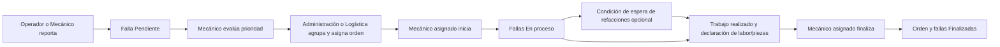

# Arquitectura propuesta

## Alcance y decisiones técnicas reversibles

Monolito modular NestJS con API REST `/api/v1`, Angular standalone y Prisma sobre MySQL. Una sola empresa, sin multiempresa, microservicios, Redis ni colas. Operación local inicial; despliegue futuro independiente de proveedor. Fase 1 usa Node 24.19.0, Angular 21.2.25, TypeScript 5.9.3, NestJS 12.1.3 y Prisma 7.10.1. Manifiestos y lockfile fijan versiones; véase manual-desarrollo y validacion-fase-1.

```text
tallerbus/
  frontend/src/app/{core,shared,layout,features}/
  backend/src/{auth,users,fleet,incidents,work-orders,maintenance,inventory,purchasing,reports,audit}/
  backend/prisma/{schema.prisma,migrations}/
  docs/
  scripts/
```

Fase 1 implementa core, shared, layout y features de Angular, módulos Nest auth/users/audit, Prisma, migraciones y scripts. Fase 2 añade módulo Nest fleet, vistas de autobuses y dashboard real. Fase 3 añade incidents y work-orders, evidencia privada y seguimiento. Inventario/compras/mantenimiento y reportes financieros siguen propuestos.

| Módulo | Responsabilidad | Dependencias |
|---|---|---|
| Identidad | Sesiones, roles, permisos y usuarios | Auditoría |
| Flota | Autobuses, activación, estado e historial | Identidad |
| Fallas | Reporte, prioridad, evidencia y seguimiento | Flota e identidad |
| Órdenes | Asignación, diagnóstico, trabajo y finalización | Fallas, inventario, costos |
| Inventario | Catálogo y movimientos trazables | Identidad y auditoría |
| Proveedores / compras | Compra, recepción y procedencia de costos | Inventario |
| Mantenimiento | Planes configurables y ejecuciones | Flota y órdenes |
| Costos | Consolidación exacta con origen único | Órdenes y movimientos |
| Operación / logística | Vistas por rol, coordinación | Flota y fallas |
| Reportes / auditoría | Consultas autorizadas y eventos | Dominios anteriores |

## Límites y seguridad

Controladores delgados → DTO validado → política de acceso → servicio de dominio → Prisma. Autorización por acción y alcance en servidor, denegación por defecto; no serializar entidades de usuario completas. Restricciones únicas y transacciones son la última barrera de integridad. Versiones de registros permiten rechazar actualizaciones obsoletas con 409.

Implementado en Fase 1: sesiones opacas revocables, token aleatorio con hash persistido y cookie HttpOnly; Secure en HTTPS y configuración explícita para desarrollo local. Protección CSRF para acciones con cookies, CORS con orígenes explícitos, hash Argon2id, límites de intentos y mensajes de acceso genéricos. TTL local de 8 horas y límite local de 10 intentos/IP por minuto, configurables y sujetos a validación operativa; contraseñas de desarrollo solo por entrada local segura. No almacenar credenciales en el navegador ni en seeds versionados.

Auditoría de mutaciones en la misma transacción que el cambio, con campos permitidos explícitos, sin tokens, contraseñas ni contenido sensible innecesario. Logs estructurados con identificador de solicitud y saneamiento de errores. Evidencias fuera de la raíz pública, descarga autorizada, límites configurables, validación de MIME y firma; política de almacenamiento pendiente.

UTC para persistencia y transporte ISO 8601; zona de presentación empresarial por confirmar. Dinero en Decimal y cadenas en JSON, nunca cálculos monetarios con float. Moneda, escala, redondeo e impuestos sujetos a validación. Inventario y recepción con transacción, control de concurrencia e idempotencia respaldada por unicidad.

## UX propuesta

Paleta original basada en #F3F5F9, #FFFFFF, #172B4D, #2563EB y #F4C542. No se recibieron bocetos aprobados. Menú por permisos, contexto de sesión, formularios accesibles, tablas filtrables y estados de carga/error/vacío con reintento. Prioridad móvil para operadores y taller. Validar WCAG 2.2 AA con teclado y contraste medido; no se afirma conformidad desde un diseño documental. Estados acompañados de texto. Reservar tokens de diseño para modo oscuro futuro.

## Métricas iniciales

Total = todas las unidades; activos/inactivos = bandera administrativa. Disponibles propuesto = activas y HABILITADO; taller propuesto = activas EN_REPARACION o EN_ESPERA_REFACCIONES. Mostrar FUERA_DE_SERVICIO aparte. Fallas abiertas = Pendiente o En_proceso; la espera de piezas no aumenta el conteo. Confirmar definiciones con Terrabus antes de publicarlas como métricas oficiales.

## Implementación de flota

`fleet` usa DTOs específicos para edición, activación y estado. Campos no permitidos se rechazan; roles se validan en guard de lectura y en transacciones de mutación. Las ediciones usan actualización condicionada por ID/versión: solo una petición con la versión vigente puede ganar. Auditoría y cambio se confirman en la misma transacción. AuditEvent incluye FK busId restrictiva, impidiendo borrar una unidad con historial.

Placas canónicas: uppercase y eliminación de espacios/guiones, con índice único; económico uppercase/trim único. Kilometraje entero 0–2147483647, validado por DTO y CHECK SQL de no negatividad. No se impone incremento monótono para permitir correcciones auditadas; el motivo acompaña las ediciones.

Indicadores implementados: total, activos, inactivos, disponibles, en taller y distribución por estado (todas las unidades). Provienen de un groupBy de MySQL, sin datos demo implícitos. No se muestran fallas abiertas hasta implementar ese dominio. Desactivación no altera estado operativo. No hay automatismos de habilitación.

## Flujo de Fase 3



No se altera el estado de Falla para la espera. La unidad mantiene su estado operativo hasta que un rol autorizado lo cambie manualmente; las fallas no bloquean habilitarla, conforme a la decisión del usuario. No hay cambios silenciosos a la máquina de estados.

Incidents aplica alcance por propietario en servidor para Operador. Work-orders revalida actor y asignación dentro de la transacción. Las mutaciones cruzadas bloquean en orden unidad → orden/falla y usan aislamiento ReadCommitted para releer después de bloquear, evitando que una instantánea antigua permita decisiones obsoletas. Versiones, índices únicos y auditoría en la misma transacción evitan sobrescrituras y cierres duplicados. Una FK compuesta de Falla a OrdenTrabajo obliga a que ambas pertenezcan al mismo autobús.

Evidencias PNG/JPEG de hasta 5 MB: firma básica y MIME concordantes; claves aleatorias, hash SHA-256, carpeta privada y descarga autenticada como attachment con no-sniff. No se usan nombres originales como rutas ni URLs públicas. Al descargar se comprueban tamaño y hash. Esto no constituye antivirus ni validación completa del códec. Un fallo transaccional elimina el archivo recién creado; un corte abrupto puede dejar un huérfano que requiere conciliación operacional.

El cierre guarda minutos enteros de trabajo y cantidades Decimal(12,3) como cadenas JSON, con responsable y fecha del servidor. Las piezas son registro descriptivo de procedencia, sin descuentos de stock ni importes supuestos. La Fase 4 deberá enlazar estos registros a catálogo/movimientos sin duplicar consumos o costos.
