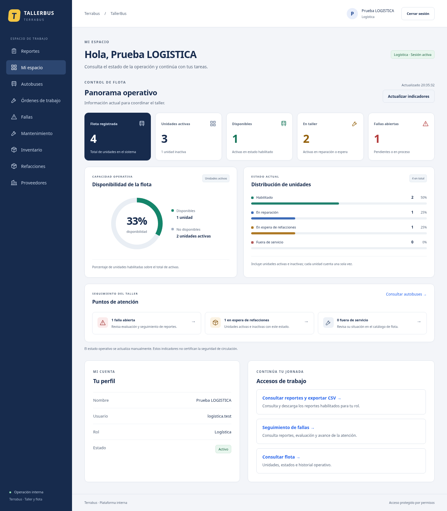

# Dashboard operativo — 27 de octubre de 2026

El inicio de Administración, Logística y Mecánico presenta tarjetas de indicadores, gráfico de disponibilidad, barras por estado y puntos de atención con enlaces a flota/fallas. Operador y Contabilidad conservan su inicio y sus reportes autorizados. No se amplían permisos ni se añaden importes financieros.

## Interpretación de indicadores

- **Flota registrada:** todas las unidades.
- **Activas:** bandera administrativa; inactivas se informa por separado.
- **Disponibles:** activas y HABILITADO.
- **En taller:** activas en reparación o espera de refacciones.
- **Fallas abiertas:** pendientes o en proceso, según el alcance vigente del servidor.
- **Disponibilidad:** disponibles / activas × 100, redondeada a entero. Sin activas se muestra —, sin división por cero.
- **Distribución:** incluye todas las unidades, activas e inactivas; cada barra usa total como denominador. Porcentajes redondeados de forma independiente.
- **Puntos de atención:** fallas abiertas y unidades en espera/fuera de servicio. Estas últimas incluyen activas e inactivas como la distribución; no deben sumarse al KPI En taller ni interpretarse como una cantidad única de pendientes.

El estado operativo sigue siendo manual; los indicadores no certifican seguridad de circulación. No se inventan tendencias históricas, porcentajes de crecimiento ni series temporales. Las cifras proceden de los endpoints existentes, sin migraciones ni cambios de BD.

## Actualización y fallos

Actualizar indicadores vuelve a consultar flota y fallas; no hay actualización automática continua. La hora mostrada corresponde a la última consulta correcta de flota en la hora del navegador, sin prometer una zona empresarial. Mientras carga se muestra estado accesible y se impide repetir la petición.

Una falla de consulta de incidentes conserva flota y muestra — con explicación, en lugar de cero. Una falla de flota muestra error y reintento, sin mantener cifras antiguas como actuales. Los accesos de puntos de atención llevan a los listados generales; no aplican filtros que esos listados no soportan por URL.

## Diseño y validación

Componentes y estilos propios sin nuevas dependencias: tarjetas alineadas, color acompañado de etiquetas, gráficos con equivalentes textuales, foco de teclado y diseño para escritorio/tablet/320 px. El inicio elimina el bloque decorativo anterior y deja perfil/accesos bajo el resumen.

Pruebas de navegador cubren datos reales y cero unidades, cálculo sobre activas frente a total, disponibilidad sin datos, fallos parciales y recuperación, permisos sin llamadas de flota para Operador/Contabilidad, análisis axe y ausencia de desbordamiento a 320/768 px. Se revisaron capturas de escritorio y móvil. No se afirma certificación WCAG ni validación en la computadora del usuario.

## Vista previa

Capturas de la aplicación real con datos ficticios de prueba; no representan datos del usuario.

[Ver captura de celular a 320 px](images/dashboard-celular.png).

## Resultado de las comprobaciones

Lint, tipos y compilación aprobados. Se ejecutaron 14 E2E de dashboard, flota, fundamentos y accesibilidad: nueve recorridos existentes aprobados y los cinco nuevos del dashboard aprobados tras su ajuste final. El primer intento de uno de los casos nuevos tenía un selector ambiguo para dos títulos de perfil; se precisó el selector y se repitieron satisfactoriamente los cinco casos nuevos. No se cambió ninguna regla del producto para hacer pasar esa prueba. No se repitieron integración/unitarias de backend porque este cambio no modifica sus contratos o servicios.
