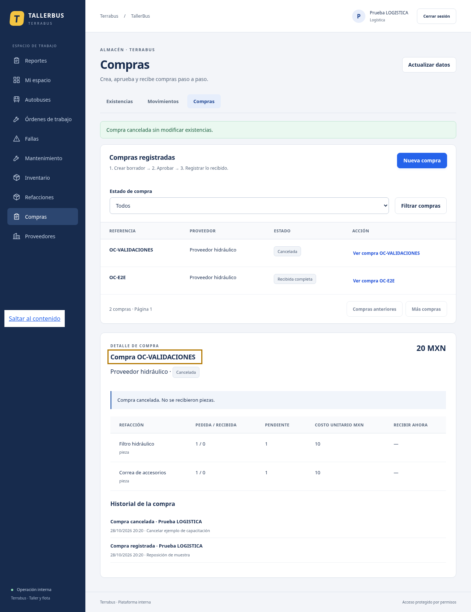
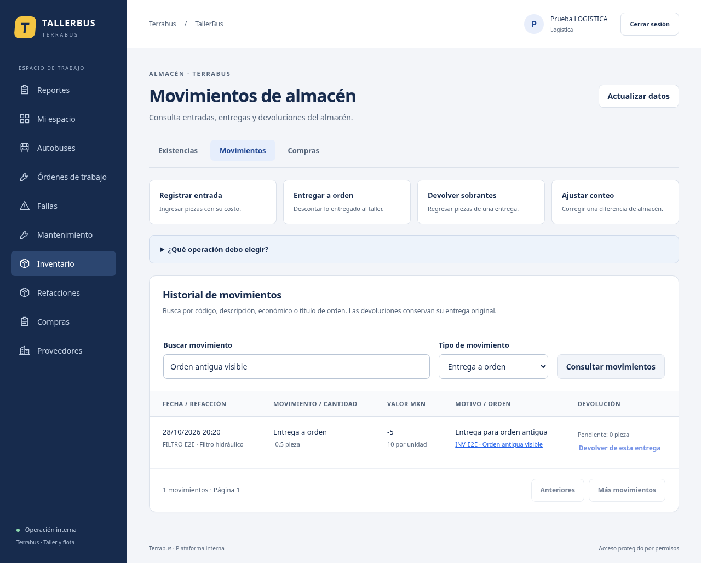

# Inventario: guía por tarea — 28 de octubre de 2026

## Contabilidad: consultar y exportar

En el menú o Mi espacio, elige **Inventario (consulta)** para cantidades y valoración actual; **Compras (consulta)** para lo pedido/recibido. El reporte se selecciona automáticamente. Escribe tus filtros, pulsa Consultar reporte y luego Exportar CSV con filtros. No necesitas abrir formularios de almacén ni registrar una compra para consultar datos.

Contabilidad sigue sin registrar entradas, entregas, devoluciones, ajustes, compras, aprobaciones o recepciones. Tampoco ve contactos privados de proveedores. Los permisos financieros aprobados no cambian.

## Logística: tres secciones

- **Existencias:** código/descripcion, cantidad disponible, mínimo y valoración. Buscar por código o descripción no cambia los formularios. Los accesos Entrada/Entregar de cada fila ya seleccionan la pieza.
- **Movimientos:** historial con búsqueda por código, descripción, económico o título de orden; filtro por tipo; vínculo legible a la orden y pendiente de devolver.
- **Compras:** lista por estado, Nueva compra y detalle con pasos: crear borrador → aprobar → recibir. También tiene su propio acceso en el menú principal.

Los cuatro botones de operación abren solo el formulario necesario. No hay que recorrer una página con todos los formularios abiertos.

| Necesitas… | Usa… | Qué ocurre |
|---|---|---|
| Ingresar piezas sin compra registrada | Registrar entrada | Cantidad y costo unitario aumentan stock/valor |
| Dar piezas a una reparación | Entregar a orden | Descuenta al entregar a orden abierta/en proceso |
| Regresar piezas no usadas | Devolver sobrantes | Selecciona la entrega original y repone su costo histórico |
| Corregir diferencia de conteo | Ajustar conteo | Cantidad positiva suma; negativa resta; siempre con motivo y sin stock negativo |
| Recibir mercancía de una compra | Compras → Ver compra → Recibir ahora | Ingresa lo recibido; no lo dupliques como entrada directa |

## Antes de la primera operación

En Refacciones registra un **código de refacción (SKU)** propio, descripción, unidad y mínimo. Código es simplemente el identificador único, por ejemplo FIL-001; no requiere código de barras. Para compras registra también un proveedor. Los enlaces dentro de formularios abren el catálogo en otra pestaña para no descartar lo capturado; después vuelve y usa Buscar piezas/Buscar proveedores para actualizar opciones.

## Entregar a una orden

Busca por título o económico; aparecen abiertas y en proceso, aunque existan muchas finalizadas recientes. El selector carga hasta 100 de cada estado: afina la búsqueda si hace falta. Desde el detalle de una orden, Entregar piezas a esta orden abre el formulario con su orden seleccionada. Una finalizada no acepta nuevas entregas.

## Devolver sobrantes

Busca la entrega por pieza, unidad o título de orden. Se consultan **entregas**, no solamente los últimos movimientos de cualquier tipo; hay paginación. Selecciona el origen y revisa cuánto se ha devuelto y cuánto queda. Una entrega completamente devuelta queda deshabilitada. Se permite devolver después de cerrar la orden, conservando su vínculo original. La validación definitiva sigue siendo transaccional en servidor, también ante devoluciones concurrentes.

## Compras sin confusión

1. En Compras, pulsa Nueva compra y elige proveedor.
2. Captura referencia, partidas distintas, cantidades/costos y motivo. Usa punto decimal.
3. Guardar borrador no modifica existencias. El detalle muestra total, estado y el siguiente paso.
4. Aprobar compra tampoco ingresa stock; permite registrar recepción.
5. En Recibir ahora escribe lo que llegó, sin exceder el pendiente. Deja vacías las partidas no recibidas. Se muestra pedido, recibido y pendiente por separado.
6. Confirmar recepción actualiza stock y estado parcial/completo. No registrar otra entrada directa por esa mercancía.

Cancelar exige motivo y confirmación, y solo se permite antes de recibir. No hay impuestos, descuentos, pagos ni devolución a proveedor implementados. No se puede editar un movimiento ya registrado para ocultar errores: consultar al responsable y conservar trazabilidad.

## Validación y mensajes

Los formularios explican cantidad mayor que cero, máximo de tres decimales, costo no negativo de hasta seis y partidas duplicadas. Los ajustes son los únicos que admiten cantidad negativa. Se conserva precisión exacta en cálculo de pendientes y presentación monetaria; no se convierte dinero a Number.

Los mensajes de operación aparecen dentro del formulario. Durante envío se impide editar/enviar de nuevo. Ante una respuesta de red incierta, conservar los datos y reintentar el mismo formulario; revisar historial antes de iniciar otra operación. Las claves idempotentes y controles de stock del servidor se conservan.

Cerrar sin guardar conserva los valores solo mientras sigas en esa página/componente: no equivale a un borrador guardado en BD. Solo Guardar borrador envía una compra. No se asegura persistencia de campos sin enviar al cerrar navegador o cambiar de página.

## Otros roles

Administración y Mecánico consultan existencias sin importes; se explica que Logística opera. Operador no accede al almacén. No se han ampliado permisos para resolver problemas de interfaz.

## Cambios técnicos y validación

Sin migraciones ni cambios de reglas de negocio. GET inventario/movimientos añade filtro tipo, búsqueda y vínculo de orden, y devuelto/pendienteDevolver para entregas. Filtra y cuenta en servidor antes de paginar. Solo Logística accede como antes.

Comprobados: compras/recepciones, entrega/devolución, cierre sin segundo consumo, búsquedas independientes, orden abierta anterior a 105 finalizadas, entrega fuera de los últimos 20 movimientos, devolución excesiva/completa, partidas duplicadas, conservación de piezas seleccionadas al buscar y acceso directo de Contabilidad sin formularios de escritura. Se ejecutaron lint, tipos, build, 18 unitarias, 122 integraciones y 13 E2E relevantes (153 pruebas), con cero fallidas/omitidas en las ejecuciones finales. Se revisan capturas con fixtures; no son datos del usuario ni certificación WCAG/Windows.

## Vista previa con datos ficticios

En una entrega, pendiente de devolver indica **el máximo que todavía se puede devolver**, no una obligación de regresar piezas que sí se utilizaron. En una compra, pendiente de recibir sí indica la diferencia entre pedido y recibido.
