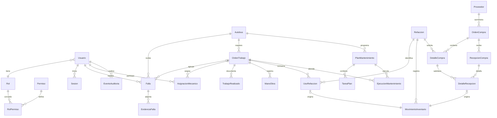

# Modelo de datos preliminar

**Propuesta, no schema definitivo ni migración ejecutable.** Preguntas previas: ¿varias fallas por orden?, ¿varios almacenes?, ¿quién aprueba compras?, ¿cómo se costea mano de obra?, ¿cómo se vinculan operadores y unidades?, ¿qué reglas preventivas se aplican? Véase decisiones pendientes.

El diagrama expresa relaciones propuestas; el movimiento también admite ajuste o devolución sin recepción/consumo. Esas procedencias serán mutuamente excluyentes por validación y restricción según soporte MySQL.

| Entidad | Campos / restricciones preliminares |
|---|---|
| Usuario, Rol, Permiso, RolPermiso | ID estable, identificador de acceso único, hash privado, activo, rol; permisos de acción únicos; combinación rol/permiso única. Un rol por usuario inicialmente, por validar |
| Sesion | Hash de token único, usuario, expiración, revocación; nunca token en auditoría |
| Autobus | ID, número económico único, placas, marca, modelo, kilometraje no negativo, activo, estado operativo, timestamps, versión. Unicidad/normalización de placas pendiente |
| Falla | Autobús, reportante, descripción, fecha, tipo, prioridad confirmada por mecánico, estado, orden opcional, versión. Índices por unidad/estado y responsable/fecha |
| EvidenciaFalla | Falla, autor, clave privada de almacenamiento, MIME validado, tamaño y checksum; sin URL pública |
| OrdenTrabajo | Autobús, diagnóstico, estado propio por acordar, responsables, fechas, versión. Varias fallas por orden propuesta; una falla en máximo una orden; exigir misma unidad |
| AsignacionMecanico | Orden, mecánico, asignador, aceptación y vigencia. Evitar asignaciones activas duplicadas |
| TrabajoRealizado, ManoObra | Orden, autor, descripción/observaciones; horas exactas y tarifa histórica si aprobada. Finalización guarda fecha y responsable |
| Refaccion, MovimientoInventario | SKU único, unidad, mínimo configurable; cantidad exacta, tipo, motivo, responsable, origen único, costo histórico Decimal, idempotency key única |
| UsoRefaccion | Orden, artículo, cantidad y movimiento único; devoluciones con movimiento compensatorio, sin editar historia |
| Proveedor | Identificador, datos comerciales mínimos, contacto protegido, activo |
| OrdenCompra, DetalleCompra | Proveedor, estado por validar, autor; artículos, cantidades y precios Decimal. Sin reglas fiscales ni aprobación inventadas |
| RecepcionCompra, DetalleRecepcion | Orden, responsable, fecha, idempotencia; línea comprada, cantidad recibida y costo histórico. Impedir exceso y recepción duplicada transaccionalmente |
| PlanMantenimiento, TareaPlan | Unidad, tipo, frecuencia por tiempo/km configurable, activo, tareas versionadas; al menos un umbral válido |
| EjecucionMantenimiento | Plan, orden, fecha/km y checklist histórico; una orden no debe generar consumo duplicado |
| EventoAuditoria | Entidad, ID, acción, actor, UTC, motivo y cambios permitidos; índices entidad/ID/fecha y actor/fecha |

## Integridad y ciclo de vida

FK restrictivas para unidades, usuarios, piezas, órdenes y documentos con historial. Preferir desactivación; no cascada sobre registros operativos. Cascade solo para relaciones auxiliares sin historia tras justificación. Guardar createdAt/updatedAt y version donde exista edición concurrente. IDs opacos; UTC con precisión coherente. Índices adicionales se validan con consultas reales.

Falla mantiene **Pendiente → En_proceso → Finalizada**. Propuesta: espera de refacciones como condición de la orden, con eventos de inicio/fin; no añadir un cuarto estado de falla sin aprobación. Finalizar exige trabajo, observaciones, fecha, responsable y declaración explícita de piezas/mano de obra aplicables. No habilita automáticamente la unidad mientras falte política de fallas bloqueantes.

Fuente de costos: consumo real proviene de movimientos de salida vinculados; mano de obra de registros aprobados. Compra/recepción es adquisición, no un segundo gasto por autobús. Estimaciones separadas. No sumar compra y consumo como costo operativo duplicado. La implementación de Fase 4 resuelve descuento al entregar y promedio ponderado MXN, según la sección posterior.

Stock se deriva de movimientos o saldo materializado validado dentro de la misma transacción; impedir negativos mediante bloqueo/actualización condicional y comprobar filas afectadas. Recepción y consumo tienen claves de idempotencia únicas; reintentar no duplica efectos. Pruebas de concurrencia requeridas antes de considerar listo el módulo.

Prisma schema y SQL versionado se escribirán por fase después de validar el alcance; restricciones que Prisma no exprese deberán vivir en migraciones SQL compatibles y probadas. No hay autorización para migrar datos productivos.

## Implementado en Fase 1

El schema y la migración inicial implementan User, enum Role, Session, AuditEvent y AdminLock. Los otros modelos del ER son preliminares. Los permisos base se expresan mediante guards por rol, sin tablas de permisos granulares todavía. AuditEvent solo almacena las proyecciones permitidas de usuarios y acciones, no contraseñas ni tokens. Session almacena hash y vencimiento; AdminLock contiene una fila fija como mutex transaccional para preservar el último administrador.

## Implementado en Fase 2

Autobus y enum EstadoOperativo están en schema y migración `20261017200000_fleet`. Placas y número económico únicos, índices activo/estado y fecha/ID. AuditEvent incorpora busId opcional y FK restrictiva para las mutaciones de unidades, conservando compatibilidad con los eventos de identidad existentes. `20261017200100_fleet_checks` añade CHECK de kilometraje no negativo y versión positiva, que Prisma no representa en schema.

La activación no afecta el estado; todos los cambios usan version y eventos con antes/después, actor, UTC y motivo. No se implementaron aún Falla, OrdenTrabajo, costos ni mantenimiento. El detalle solo muestra resumen e historial reales; no presenta pestañas vacías para dominios futuros.

## Implementado en Fase 3

Migración `20261017210000_incidents_orders`: Falla, EvidenciaFalla, OrdenTrabajo, AsignacionMecanico, FinalizacionOrden y RefaccionDescriptiva. AuditEvent incorpora fallaId y ordenId opcionales con FK restrictivas. User y Autobus conservan sus IDs y registros previos.

Cardinalidades aprobadas: autobús 1:N fallas/órdenes, orden 1:N fallas, falla 0:1 orden. FK compuesta (ordenId, autobusId) → orden (id, autobusId) impide agrupar unidades distintas también desde SQL. Orden 1:N asignaciones históricas; activeKey nullable único evita dos asignaciones vigentes del mismo mecánico a una orden, conservando múltiples periodos retirados. Orden 0:1 finalización mediante índice único; cada finalización tiene responsable, fecha, labor y 0:N piezas descriptivas.

Prioridad es nullable hasta evaluación mecánica. EstadoFalla solo PENDIENTE/EN_PROCESO/FINALIZADA; EstadoOrden ABIERTA/EN_PROCESO/FINALIZADA y esperaRefacciones como condición independiente. La finalización cierra todas las fallas vinculadas en una transacción y termina la condición de espera, conservándola en auditoría.

CHECKs SQL validan versiones positivas, texto/fecha de evaluación cuando hay prioridad, tamaño de evidencia, coherencia de minutos con labor declarada y cantidades positivas. La autoría de evaluación se valida en servicio y FK; MySQL no admite su columna con acción referencial CASCADE dentro del CHECK. No hay borrados físicos ni reaperturas implementados.

En la entrega original de Fase 3 no existía catálogo/movimiento real de refacciones. RefaccionDescriptiva sigue siendo registro de uso declarado; Fase 4 añade ledger separado y no la transforma automáticamente en movimientos ni costos.

## Implementado en Fase 4

La migración aditiva `20261020120000_inventory_catalog` añade Refaccion, Proveedor, SaldoInventario, MovimientoInventario, Compra, LineaCompra, RegistroCompra, OperacionInventario e InventoryLock. No cambia ni valoriza automáticamente RefaccionDescriptiva. AuditEvent incorpora FK restrictivas opcionales de pieza/proveedor. El costo neto de una orden procede exclusivamente del valor de ENTREGAS menos DEVOLUCIONES relacionadas.

Refaccion 0:1 saldo materializado por almacén único, 1:N movimientos y líneas de compra. Proveedor 1:N compras; compra 1:N líneas y registros privados. Una línea por pieza/compra evita duplicados ambiguos. Línea 1:N movimientos de recepción; recibida se actualiza con el movimiento dentro de la misma transacción. Compra tiene versión y aprobador/fecha; RegistroCompra conserva acción, motivo privado, actor y UTC. Movimientos guardan actor, descripción/unidad, valor/costo histórico, saldo posterior y vínculos opcionales a orden, recepción u origen de devolución.

Saldo usa Decimal(15,3) y valor Decimal(30,6); costo unitario de compra Decimal(18,6), cantidades de línea Decimal(12,3). No usar punto flotante para dinero. CHECKs exigen mínimo/saldo no negativos, saldo sin valor residual cuando cantidad es cero, versiones positivas, recibido entre cero y pedido, cantidades y signos coherentes en el ledger. FK restrictivas conservan trazabilidad. La inmovilidad del ledger se impone mediante la API (sin edición/borrado), no mediante privilegios de solo inserción del usuario SQL de desarrollo.

Un bloqueo de almacén protege cambios de catálogo, saldo, compras e idempotencia; operaciones financieras READ COMMITTED. Las entregas coordinan bloqueo de autobús/orden con su finalización. No hay reservas, multi-almacén, impuestos, pagos, costos laborales o migración de históricos implementados. Las descripciones de cierre siguen siendo evidencia del trabajo, separada de la fuente contable de inventario.

## Implementado en Fase 5

`PlanPreventivo` pertenece a un autobús; contiene nombre único por unidad, intervalo entero en kilómetros, lectura del último servicio, checklist plantilla JSON validado, activo y versión. No se replica un catálogo de intervalos supuestos ni se programa por calendario.

`EjecucionPreventiva` pertenece a un plan y una orden única y copia nombre, intervalo, base y objetivo al programar. FK compuestas con autobusId impiden vincular plan/orden de unidades distintas. `activeKey` única nullable contiene ID del plan mientras está abierta y se libera al finalizar; CHECK impone coherencia de cierre, lectura y clave. `PasoPreventivo` conserva posición/texto histórico, estado y observaciones; no hay edición después del cierre por API. La orden mantiene sus asignaciones y responsable de finalización existentes.

El cierre registra kilometrajeCierre/UTC, actualiza último servicio/version del plan y finaliza la orden en una transacción sin stock nuevo. Cambios posteriores de plantilla no alteran snapshots. El siguiente objetivo usa la lectura real de cierre y el intervalo vigente del plan. La auditoría genérica de plan incluye busId/ordenId cuando procede, actor, acción y motivo; no incluye importes. No hay borrado por API; ejecuciones tienen FK restrictivas hacia plan y orden.
